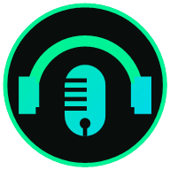
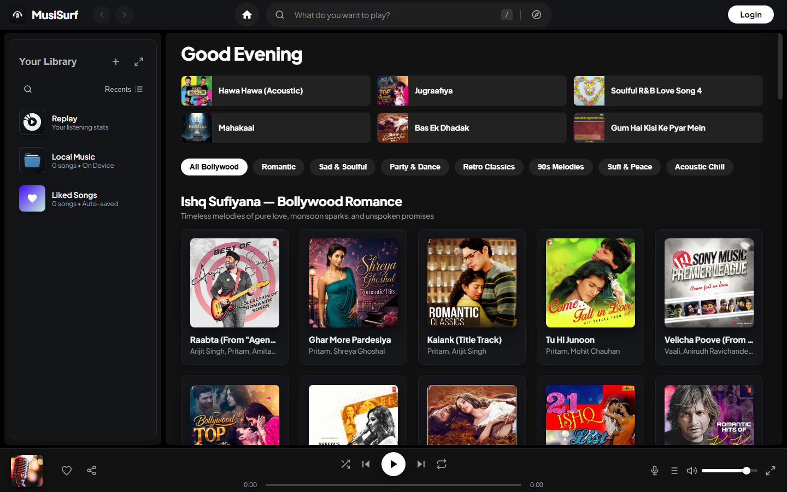

<div align="center">

#  MusiSurf

<br/>



</div>

---

## ✨ Features

- 🛡️ **100% Ad-Free Architecture**: Absolutely zero advertisements anywhere. No audio ads, no video prerolls, no banner commercials, no sponsored results, and no tracking pixels.
- 🎵 **Strict Pure Music-Only Search**: Powered by YouTube Music (`WEB_REMIX` client with Songs category filter) and JioSaavn's dedicated song search API. Zero gaming videos, tutorials, vlogs, reactions, podcasts, or lectures.
- ⚡ **Full-Length Song Playback**: Stream the complete duration of any song from the internet—zero 30-second preview restrictions.
- 📱 **Uninterrupted Background & Lockscreen Playback**:
  - Native background playback across mobile browsers (Android Chrome, iOS Safari) and background tabs.
  - Full MediaSession API integration with lock-screen controls, notification center playback, and Bluetooth headphone buttons.
  - Native AAC / MP4 direct audio streaming with instant byte-range scrubbing.
- 🔀 **Persistent Playlist Shuffle**: Remembers random shuffle preferences per playlist permanently across tabs and visits.
- 📱 **Mobile Responsive & Installable (PWA)**:
  - Works seamlessly on smartphones, tablets, and desktop displays.
  - Installable as a native app on Android and iOS with Progressive Web App (PWA) support.
  - Clean mobile top bar with profile login icon, bottom navigation tabs, and full-screen now-playing sheet.
- ⬇️ **Direct Mobile & Desktop Song Downloader**:
  - 1-click download button on every song row, card, and now-playing player bar.
  - Saves full-length, high-quality audio files directly into your device's Downloads folder for offline listening.
- 🎤 **Synchronized Karaoke Lyrics**: Real-time line-by-line synced lyrics powered by `lrclib.net` with interactive click-to-seek.
- 🎛️ **60 FPS Web Audio Visualizer**: Live hardware-accelerated canvas frequency visualizer featuring **Spectrum Bars**, **Neon Wave**, and **Radial Orbit** modes.
- 💖 **Liked Songs, Local Audio & Custom Playlists**: Save tracks, import local device MP3s, and organize your personal music library permanently (`localStorage` & IndexedDB).
- ⌨️ **Keyboard Shortcuts**: Control playback with Space, Arrow keys, Next (Shift+N), Previous (Shift+P), Mute (M), Lyrics (L), and Search (/).

---

## 🚀 Quick Start

### Prerequisites
- [Node.js](https://nodejs.org/) (v18 or higher recommended)
- `npm` or `yarn`

### Installation

1. **Clone the repository**:
   ```bash
   git clone https://github.com/hritikraj07/MusiSurf.git
   cd MusiSurf
   ```

2. **Install dependencies**:
   ```bash
   npm install
   ```

3. **Start the application**:
   ```bash
   npm start
   ```

4. **Open in your browser**:
   ```
   http://localhost:3000
   ```

---

## 📱 Mobile Installation (PWA)

### Android (Google Chrome / Brave)
1. Open `http://<your-ip>:3000` or deployed URL on your phone.
2. Tap the **"Install App"** button in MusiSurf or open Chrome's menu (`⋮`) and select **"Install app"** or **"Add to Home screen"**.
3. MusiSurf will appear on your home screen with its own icon and launch in full-screen standalone mode without browser bars!

### iOS (Safari)
1. Open MusiSurf in Safari.
2. Tap the **Share** button (`⎋`).
3. Scroll down and tap **"Add to Home Screen"**.

---

## ⌨️ Keyboard Controls

| Key | Action |
| :--- | :--- |
| <kbd>Space</kbd> | Play / Pause |
| <kbd>Shift</kbd> + <kbd>N</kbd> | Next Track |
| <kbd>Shift</kbd> + <kbd>P</kbd> | Previous Track |
| <kbd>→</kbd> / <kbd>←</kbd> | Seek +5s / -5s |
| <kbd>↑</kbd> / <kbd>↓</kbd> | Volume +5% / -5% |
| <kbd>M</kbd> | Mute / Unmute |
| <kbd>S</kbd> | Shuffle Toggle |
| <kbd>R</kbd> | Repeat Mode Toggle |
| <kbd>L</kbd> | Toggle Synced Lyrics View |
| <kbd>Q</kbd> | Toggle Play Queue Drawer |
| <kbd>/</kbd> | Focus Global Search Bar |
| <kbd>Esc</kbd> | Close Overlays & Modals |

---

## 🛠️ Tech Stack

- **Frontend**: Vanilla HTML5, CSS3 (Modern Glassmorphism, CSS Custom Properties, Flexbox & Grid), JavaScript (ES6+), Web Audio API, Service Workers (PWA).
- **Backend**: Node.js, Express, Crypto-JS (DES audio stream decryption), CORS, HTTP streaming.
- **Audio Engines**: JioSaavn Studio API (320kbps AAC), YouTube Music Innertube (`WEB_REMIX`), LRCLIB Synced Lyrics API.

---

## 📄 License

This project is licensed under the MIT License.
